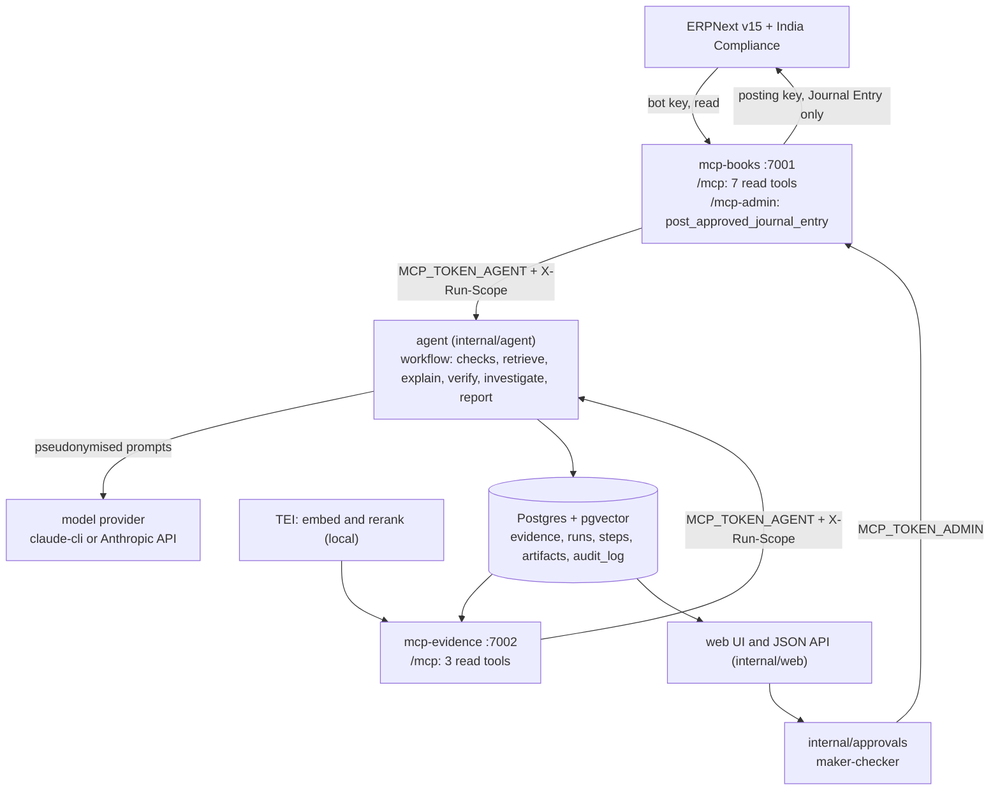

# Architecture

What runs, how one close moves through it, which MCP tools exist, and where the trust boundaries sit. Every name below is a package or binary in this repository. The doc comment at the top of each package (`doc.go`, or the file named here) is the detailed reference. All data is synthetic.

## Components

The same picture as text: ERPNext feeds the books server, and Postgres (with TEI for search) feeds the evidence server. The agent reads both over MCP and sends pseudonymised prompts to the model provider. It stores everything in Postgres, and the web app reads from there. An approval goes from the web app to `internal/approvals`, then to the books server's admin route, and from there back into ERPNext.

### Binaries (`cmd/`)

| Binary | What it does |
| --- | --- |
| `cmd/agent` | `close` runs one month-end close and `resume <run_id>` finishes one that stopped. `mint-scope` issues a run scope by hand. `serve` starts the web UI and JSON API on `APP_ADDR`, and closes started from the UI run inside this process. |
| `cmd/mcp-books` | Books MCP server. It serves the read tools on `/mcp` with the bot key (`ERP_API_KEY`) and the approved-write tool on `/mcp-admin` with the posting key (`ERP_POST_API_KEY`). Over HTTP it refuses to start without the posting pair, or if the posting pair equals the bot's. |
| `cmd/mcp-evidence` | Evidence MCP server: bank lines, GSTR-2B entries and document search, all from Postgres. |
| `cmd/audit` | `rebuild <finding-id>` rebuilds a finding from its stored artifacts and re-runs the verifier offline. |
| `cmd/eval` | `run` closes a suite live, recording (`--record`) or replaying fixtures (`--replay`), with the model on or off. `score` grades the results against ground truth and compares them with `evals/baseline.json`. |
| `cmd/seed` | Generates the synthetic world, posts its books to ERPNext, writes `bank.csv` and `gstr2b.json`, and writes the ground truth. |
| `cmd/load` | Loads bank statements and GSTR-2B files into Postgres, replacing a company-period's rows. |
| `cmd/ingest` | Converts the document corpus with docling, then chunks it, embeds it with TEI and stores it in `doc_chunks`. |
| `cmd/probe` | Checks the ERPNext API keys and permissions, and dumps DocType schemas to `docs/erpnext-schema/`. |

### Packages (`internal/`)

| Package | Role |
| --- | --- |
| [`internal/agent`](../internal/agent/) | The close workflow (`workflow.go`), explainer (`explain.go`), verifier (`verify.go`, `verify_amounts.go`), investigator (`investigate.go`), question router (`triage.go`), ask pipeline (`ask.go`), retrieval step (`retrieve.go`), pseudonymiser (`redact.go`), MCP registry and snapshotting readers. It never imports `internal/frappe`. |
| [`internal/checks`](../internal/checks/) | Deterministic checks: bank reconciliation, duplicate payments, GSTR-2B matching, missing accruals, policy rules, variance, suspicious text. Plain Go with no model. |
| [`internal/books`](../internal/books/) | The seven read-only books tools, the trial balance and account history reports, and the admin tool `post_approved_journal_entry` (`admin.go`). |
| [`internal/evidence`](../internal/evidence/) | Bank and GSTR-2B parsers and loaders, and the three evidence tools. |
| [`internal/retrieval`](../internal/retrieval/) | TEI and docling clients, chunking, ingestion, and hybrid search (vector plus full text, merged with RRF, then reranked). |
| [`internal/approvals`](../internal/approvals/) | Maker-checker on journal proposals, and the only package that uses the MCP admin token. |
| [`internal/web`](../internal/web/) | Server-rendered UI (templ + htmx) and JSON API: login, roles, runs, findings, approvals, `/api/ask`, rate limits, the audit log (`/audit`, checkers only) and per-run metrics (`/runs/{id}/metrics`). |
| [`internal/mcpkit`](../internal/mcpkit/) | Shared MCP server scaffold: Streamable HTTP and stdio, bearer auth, run scopes, the audit decorator, per-token rate limits. |
| [`internal/store`](../internal/store/) | The Postgres layer, and the run data plane: `run_steps`, content-addressed `artifacts`, `llm_calls`. |
| [`internal/llm`](../internal/llm/) | Provider interface with two implementations, `claude-cli` (local `claude -p`) and Anthropic. Also prompt caching, retries and per-call cost from `config/pricing.yaml`. |
| [`internal/evals`](../internal/evals/) | Suite runner, scorer, fixtures recorder and replayer, baseline compare, faithfulness judge. |
| [`internal/seed`](../internal/seed/) | Synthetic world generator for two companies, the error planter and the ground truth writer. |
| [`internal/frappe`](../internal/frappe/) | Typed ERPNext REST client, used by the books server, the seeder and the probe. |
| [`internal/money`](../internal/money/) | `int64` paise, parsing and Indian-grouped formatting. The only package that converts to or from floating point. |
| [`internal/ledger`](../internal/ledger/), [`internal/company`](../internal/company/) | ERPNext-free accounting types, company profiles and check rules. They let checks and the agent work without the ERPNext client. |
| [`internal/httpx`](../internal/httpx/) | Builds every outbound HTTP client, and refuses hosts outside the configured services. |
| [`internal/telemetry`](../internal/telemetry/) | OpenTelemetry traces over OTLP/HTTP to Langfuse. Prompts are not traced unless `TRACE_PROMPTS` is set, and the production compose file fixes it to `false`. |

### Stores and services

- **Postgres 17 with pgvector.** Evidence (`bank_lines`, `gstr2b_entries`), documents (`doc_chunks`: 384-dimension embeddings with an HNSW index and a generated `tsvector`), runs (`close_runs`, `findings`, `journal_proposals`, `audit_log`), and the data plane (`run_steps`, `artifacts`, `llm_calls`). See [ADR 0003](../adr/0003-postgres-pgvector-not-a-vector-db.md).
- **TEI**, two local servers: `bge-small-en-v1.5` for embeddings and `bge-reranker-base` for reranking. Neither is generative, and in production they run offline after one model download.
- **docling** converts PDFs during ingestion only.
- **ERPNext version-15 with India Compliance** holds the books. The agent never talks to it directly.

## Data flow: one close

This is a run of `agent close --company sharma --month 2026-09`, or a maker pressing "start" in the UI. The run moves through `queued → preflight → checking → retrieving → explaining → verifying → investigating → synthesizing → done | partial | failed`. Every step is a `run_steps` row keyed by (run, kind, subject), so `agent resume` skips the finished steps and re-runs the rest.

1. **Start.** The workflow creates a `close_runs` row and mints a run scope: company and month, signed with `MCP_SCOPE_KEY`, short-lived. Every MCP request in the run carries it as `X-Run-Scope`.
2. **Preflight.** The router step checks that the month's evidence is loaded, using one read-only `list_bank_lines` call. If it isn't loaded, the run is refused with a reason before any check runs.
3. **Checking.** Each check reads the books and evidence through MCP-backed readers. Every tool result is stored as a content-addressed `tool_result` artifact (a snapshot). A finding is committed only when every evidence reference names a stored artifact.
4. **Retrieving.** For each finding, code builds a query from the finding and calls `search_documents` under the run's scope. The top passages are stored as a retrieval artifact. If the search fails, only that step fails, and the finding is explained without documents.
5. **Explaining.** Each finding gets one model call, several in parallel. The prompt holds the cached rules and account list, the projected evidence and the passages, each fenced. It is pseudonymised first. The model must answer through `emit_explanation`. The prompt, response, tokens and cost go to `artifacts` and `llm_calls`, and the decoded answer becomes an explanation artifact.
6. **Verifying.** The verifier (plain Go) reads the explanation and evidence artifacts and checks every amount, citation, journal line and the scope. A failed verdict reopens the explain step with the violations as feedback, up to three explain attempts in all, after which the finding is `needs_review`.
7. **Investigating.** For each `unmatched_bank_line` finding, the bounded investigator runs, followed by a verify step for its answer. No binary wires an investigator in yet, so today this records one skipped `investigate/close` step.
8. **Synthesizing.** The workflow writes the run report (Markdown, under the results directory and as an artifact) and sets the final status. A daily model budget (`LLM_DAILY_BUDGET_USD`) and a per-run token cap (`LLM_RUN_TOKEN_CAP`) stop model work when they are reached.
9. **Review and approval.** In the web app, a viewer reads the runs and findings. A maker accepts or dismisses findings, and proposes the journal entry of a verified, open finding. A different checker approves it. `internal/approvals` then calls `post_approved_journal_entry` on `/mcp-admin` with the admin token. The books server reads the lines from the approved proposal, posts and submits the Journal Entry with the posting key, and records it. Calling it again for the same proposal returns the first result and writes nothing.
10. **Audit.** Both MCP servers write an `audit_log` row for every tool call. The actor is `agent:run/<run_id>` for scoped calls and the checker's name for a post. Checkers read the log in the web app at `/audit`. `cmd/audit rebuild <finding-id>` prints the evidence the model saw, every model call and the verdict, and re-runs the verifier from stored artifacts alone.

A question on `POST /api/ask` follows the same pattern, in separate stages. The router screens the question. A bounded read-tool loop gathers numbers and never sees document text. Code retrieves the passages. One forced `emit_answer` call writes the answer, which is verified. If the answer fails verification twice, the caller gets a fixed text.

## MCP tool catalog

Both servers speak MCP over Streamable HTTP (and stdio for a desktop client). Every `/mcp` request needs `Authorization: Bearer <MCP_TOKEN_AGENT>`, and a scoped path also needs a valid `X-Run-Scope`. Every tool takes a company ID such as `sharma`, not the ERPNext company name. Amounts are integers in paise, dates are `YYYY-MM-DD` and months `YYYY-MM`. The purposes and arguments below come from the tool definitions in `internal/books/tools.go`, `internal/books/admin.go` and `internal/evidence/tools.go`. [docs/mcp.md](mcp.md) covers running and inspecting the servers, but its evidence list leaves out `search_documents`.

| Server and route | Tool | Purpose | Key arguments | Read-only |
| --- | --- | --- | --- | --- |
| books `:7001` `/mcp` | `get_trial_balance` | Trial balance for a date range from submitted GL Entries: opening, period debit and credit, closing per leaf account, plus totals | `company`, `from_date`, `to_date` (at most 400 days) | yes |
| books `:7001` `/mcp` | `list_gl_entries` | Submitted, uncancelled GL Entries posted in a date range, 500 a page | `company`, `from_date`, `to_date`, optional `account`, `party`, `cursor` | yes |
| books `:7001` `/mcp` | `list_purchase_invoices` | Submitted supplier bills with GSTIN, bill number and date, taxable value, IGST/CGST/SGST, expense lines and tax rows | `company`, `from_date`, `to_date`, optional `supplier` | yes |
| books `:7001` `/mcp` | `list_sales_invoices` | Submitted sales invoices with customer, totals, outstanding, lines, tax rows and `collected_via` | `company`, `from_date`, `to_date` | yes |
| books `:7001` `/mcp` | `list_payments` | Submitted payment entries with amount, bank reference, accounts and the invoices each settles | `company`, `from_date`, `to_date`, optional `party` | yes |
| books `:7001` `/mcp` | `get_account_history` | Monthly debit, credit and net of one leaf account over 1 to 12 months | `company`, `account`, `months`, optional `through_month` | yes |
| books `:7001` `/mcp` | `list_recurring_suppliers` | Suppliers that billed regularly before a month, with median bill, typical day and months seen | `company`, `before_month`, `lookback_months`, `min_occurrences`, optional `amount_band_pct` | yes |
| evidence `:7002` `/mcp` | `list_bank_lines` | Bank statement lines in a date range, ordered by date and `txn_id` | `company`, `from_date`, `to_date`, optional `min_amount` (paise, absolute) | yes |
| evidence `:7002` `/mcp` | `list_gstr2b_entries` | GSTR-2B inward supply entries for a return period | `company`, `period` (`YYYY-MM`), optional `supplier_gstin` | yes |
| evidence `:7002` `/mcp` | `search_documents` | Hybrid search over the policy, contract and close-note chunks the run's company may read. Snippets are at most 600 characters | `query` (at most 500 characters), optional `company` (any company but the run's is refused), `doc_types` (from the fixed list `policy`, `contract`, `close_note`), `k` (1 to 10) | yes |
| books `:7001` `/mcp-admin` | `post_approved_journal_entry` | Posts one approved proposal as a submitted ERPNext Journal Entry. Idempotent per proposal | `proposal_id` only; the lines, company and date come from the approved proposal | no (the only write tool) |

Every read tool carries the `readOnlyHint` annotation. The admin tool is annotated as not read-only, not destructive and idempotent. A golden snapshot of each tool's listing (description, annotations, input and output schemas) sits under `internal/books/testdata/schemas/` and `internal/evidence/testdata/schemas/`, and a changed schema fails the contract tests.

## Trust boundaries

### Who holds which credential

| Credential | Held by | Grants |
| --- | --- | --- |
| `ERP_API_KEY` / `ERP_API_SECRET` (`copilot-bot`, Accounts User) | `cmd/mcp-books` (read tools), `cmd/probe` | Reading the books |
| `ERP_POST_API_KEY` / `ERP_POST_API_SECRET` (`copilot-poster`) | `cmd/mcp-books`, `/mcp-admin` only | Journal Entry read, write, create and submit, nothing else |
| ERPNext seeder (Administrator) keys | `cmd/seed`, from `tmp/erp-keys.env` in a subshell | Creating masters and posting the synthetic books; development and demo set-up only |
| `MCP_TOKEN_AGENT` | `cmd/agent`, `cmd/eval` | `/mcp` on both servers |
| `MCP_SCOPE_KEY` | `cmd/agent` mints scopes; both servers verify them | One company and month per run |
| `MCP_TOKEN_ADMIN` | `internal/approvals` (inside `agent serve`); `cmd/mcp-books` verifies it | `/mcp-admin`, which is never scoped, because approvals carry no run |
| `PSEUDONYM_KEY` | `cmd/agent`, `cmd/eval` | Keyed per-run tokens for GSTINs, PANs and names |
| `APP_SESSION_KEY`, `config/users.yaml` | `agent serve` | Web sessions; bcrypt password hashes; roles viewer, maker, checker |
| `ANTHROPIC_API_KEY` | `internal/llm`, only with `LLM_PROVIDER=anthropic` | Model calls |

The static analyzers in `gates/analyzers` enforce part of this. `admintoken` confines the admin token to the code that loads, verifies and uses it. `noerpimport` keeps `internal/frappe` out of `internal/agent`. `egress` sends all outbound HTTP through `internal/httpx`. `nofloat` keeps floating point out of money code.

### What a model can and cannot call

| Model call | Tools offered | Sees |
| --- | --- | --- |
| Explainer | `emit_explanation` only, forced | The finding, the projected evidence, the account list, up to 3 retrieved passages |
| Investigator | The nine read tools (seven books, `list_bank_lines`, `list_gstr2b_entries`) and `emit_resolution` | The finding and projected tool results, with free text dropped or fenced; never document text |
| Router | `emit_route` only, forced | The company ID and the fenced question |
| Ask, number gathering | The same nine read tools and `emit_evidence` | The question and projected tool results; never document text |
| Ask, answer | `emit_answer` only, forced | The question, the gathered evidence and the retrieved passages |
| Verifier | None: plain Go | Stored artifacts |

No model is ever offered `search_documents` or `post_approved_journal_entry`. A call to a tool outside a model's allowlist is refused without being executed. The investigator stops after 8 tool calls, 90 seconds or 30,000 tokens per finding. An investigation in which any call was refused ends `needs_review`, and its proposal is dropped.

### What retrieved text can reach

Document passages come only from `search_documents`, and only code calls it: the workflow's retrieve step and the Asker's retrieval stage. Passages reach exactly two model calls, the explainer and the ask answer step. Both offer a single forced output tool and can call nothing. A poisoned passage can therefore change at most the text of one explanation or answer. That text then has to pass the verifier, and any journal entry it suggests still needs a maker and a different checker. The search filters by company inside the SQL, before ranking, so another company's chunk can't enter the top k.

### Where pseudonymisation sits

`internal/agent/redact.go` replaces GSTINs, PANs and the names of suppliers marked as individuals with per-run HMAC tokens before every model call. The wrapper sits outside the recording provider, so stored prompts hold only tokens, and the tokens are restored in what the model writes. Amounts are never changed. Embeddings run on local TEI, so the model provider is the only third party that sees data. The README's Known limitations section lists the gaps in the patterns.

### The audit trail

- `audit_log`: one row per MCP tool call on either server. The actor is set server-side from the route and scope, never from the request. A failed audit insert fails the call. The application's database role can only insert and read the table (migration 0005).
- `run_steps`, `artifacts` and `llm_calls`: every step's inputs and outputs, every prompt and response, tokens and cost. Artifacts are content-addressed, and provenance comes from `run_steps.output_refs`, never from the first writer recorded on an artifact.
- `journal_proposals`: maker, checker, status and the ERPNext entry name of every post.
